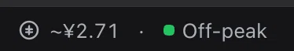
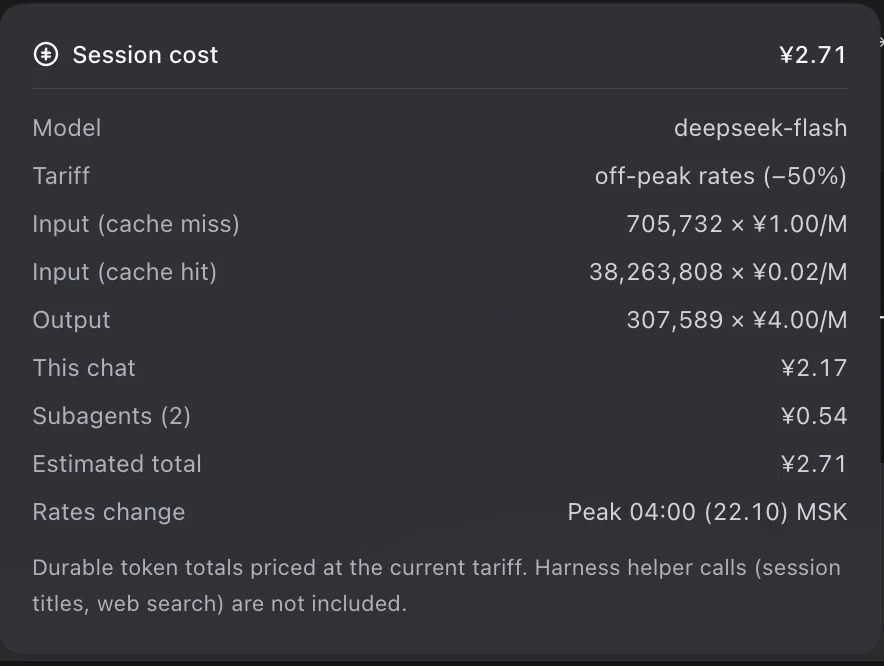

# dsh-plugin-composer-cost

[](https://github.com/nickkupriyanov/dsh-plugin-composer-cost/actions/workflows/check.yml)

A [DeepSeek Harness](https://github.com/deepseek-ai/deepseek-harness) Web UI plugin that shows **what a chat has cost** and **which DeepSeek rate window is active right now**, in the row under the composer where the token statistics already live.



Click the pill for the breakdown:



The dot is amber during peak hours and green off-peak. The panel is the same trigger-anchored dialog the neighbouring statistic pills open, and it closes on an outside click or Escape.

## What the amount covers

- **The whole chat tree.** A subagent runs as its own Session with its own durable usage, billed to the same account, so the pill sums the bound Session plus every subagent it spawned. The panel splits the two so the total stays explainable.
- **Model turns only** — the requests the provider reports usage for. See [What it cannot include](#what-it-cannot-include).

## Peak schedule

Verified against <https://api-docs.deepseek.com/quick_start/pricing> on 2026-10-14.

| Window (UTC) | Rate |
| --- | --- |
| Monday–Friday 01:00–04:00 | peak |
| Monday–Friday 06:00–10:00 | peak |
| every other instant, including the whole weekend | off-peak, exactly 50 % of peak |

Chinese statutory public holidays are off-peak for the whole day. The official 2026 list (State Council notice 国办发明电〔2025〕7号) is built in. **The 2027 notice lands in early November 2026 — add those dates to `CN_HOLIDAYS`**, otherwise January 2027 is priced as an ordinary week.

DeepSeek ignores 调休 (make-up working days): an adjusted working Saturday is still a weekend and therefore off-peak.

## Rates

Peak rates per 1,000,000 tokens, taken verbatim from the published rate cards. DeepSeek rounds CNY and USD independently, so neither is derived from the other:

| Currency | Model | Cache hit | Cache miss | Output |
| --- | --- | ---: | ---: | ---: |
| CNY | `deepseek-flash` | 0.04 | 2 | 8 |
| CNY | `deepseek-v4-pro` | 0.30 | 9 | 27 |
| USD | `deepseek-flash` | 0.006 | 0.30 | 1.20 |
| USD | `deepseek-v4-pro` | 0.044 | 1.32 | 3.96 |

Off-peak is half of each figure. `DISPLAY_CURRENCY` selects the card shown and is `CNY` by default. DeepSeek bills no separate cache-write rate, so `cacheWriteTokens` are listed but never charged. Unknown and legacy model ids fall back to the `deepseek-flash` row.

## Install

Requires a DeepSeek Harness build with the Web GUI; the plugin renders into the `conversation.composer.dock` slot.

**From the Plugins page.** Sidebar → **Plugins** → **Add plugin**, paste `https://github.com/nickkupriyanov/dsh-plugin-composer-cost`, install, then reload the page.

**From the CLI** — forwards to pnpm in the profile directory:

```sh
dsh plugin --profile <profile> add https://github.com/nickkupriyanov/dsh-plugin-composer-cost
```

**Side-loading a checkout**, without pnpm: copy the checkout into the profile and add one loader row.

```
~/.dsh/profiles/<profile>/plugins/dsh-plugin-composer-cost/
```

```yaml
# ~/.dsh/profiles/<profile>/cordis.patch.yml
- insert:
    - id: composer-cost
      name: ./plugins/dsh-plugin-composer-cost/index.js
```

Then **fully restart** the harness. The host caches client bundle bytes until a restart, and the browser module id is part of that cache key; a plain page refresh will not pick up a changed bundle.

## Configuration

No runtime options — four constants at the top of `client.js` are the knobs.

| Constant | Default | Meaning |
| --- | --- | --- |
| `DISPLAY_CURRENCY` | `'CNY'` | `'CNY'` or `'USD'`, selects the rate card |
| `RATE_ZONE` | `'Europe/Moscow'` | zone every displayed wall-clock time is expressed in |
| `RATE_CARDS` | see above | the published rate cards, one per currency |
| `CN_HOLIDAYS` | 2026 list | Chinese statutory holidays as `YYYY-MM-DD` |

## Accuracy

The durable `tokenUsage` projection carries whole-session totals with no per-request timestamps, so the cost is priced at the tariff in force at render time. A session that spans a peak boundary lands between the peak and off-peak figure; a session that never crosses one is exact.

Amounts print two decimals, and each part is rounded before summing so **This chat + Subagents** always equals the printed total. An amount that would round to zero prints `<¥0.01` rather than claiming to be free.

### What it cannot include

- **Session titles and web search.** Both are billed provider calls that the session log records as `session/title-llm-request` and `web/deepseek-search-llm-request` — requests only, with no usage attached, so no local computation can price them.
- **Other clients on the same account.** `platform.deepseek.com/usage` is account-wide; this pill is per chat.

### Comparing with the billing console

Their totals differ for two structural reasons.

1. **Scope.** A pill is the lifetime of one chat tree, not a day. A chat that ran across midnight keeps its whole total.
2. **The console day is Beijing time.** Its day starts at 00:00 Beijing = 16:00 UTC of the previous day, so a session that ran at 00:01 Beijing belongs to "today" while a UTC-day total excludes it.

Measured on 2026-10-14 at 12:34 UTC by folding every session log on one machine and pricing at the off-peak CNY card:

| Window | Total |
| --- | ---: |
| UTC day, 2026-10-14 00:00Z to now | CNY 2.0752 |
| Beijing day, 2026-10-13 16:00Z to now | CNY 2.2944 |
| console reported | CNY 2.3300 |

The Beijing-day window lands within 1.5 % of the console; the residual is the helper calls above.

## Files

| File | Role |
| --- | --- |
| `package.json` | Bundle manifest: `dsh.bundle.patch`, the `dsh.client` web half, display metadata |
| `cordis.patch.yml` | Inserts the `composer-cost` loader row |
| `index.js` | Host half — intentionally empty |
| `client.js` | The pill, its panel, styles, dictionaries, and slot registration |
| `locale/*.json` | Plugin Manager card title and description |
| `icon.svg` | Plugin Manager artwork |

No Harness Client package is imported: anchoring, outside-pointer dismissal, Escape handling and the coin glyph are implemented in `client.js` against `--dsw-*` design tokens only.

## Development

No build step and no dependencies: `client.js` is the browser artifact in the
loader lazy-factory form, checked in as source. Because nothing type-checks it
before the Harness materializes it, `scripts/check.cjs` enforces the package
contract instead - every exported entry point exists, the bundle patch names
this package, the factory id equals the package name, and no Harness Client
package is imported.

```sh
npm run check
```

CI runs the same checks on Node 20 and 22 for every push and pull request.

## License

[MIT](LICENSE)
